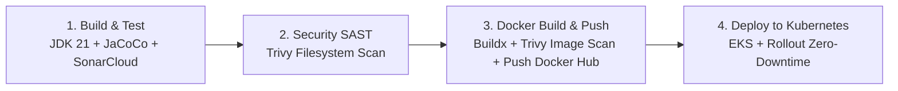

# Mecânica API

Sistema de gestão para oficina mecânica desenvolvido como projeto da **Fase 2 da pós-graduação em Arquitetura de Software (FIAP)**. A solução permite o cadastro de clientes e veículos, controle de estoque de peças, catálogo de serviços e o gerenciamento completo do ciclo de vida de uma **Ordem de Serviço (OS)** — desde a abertura, diagnóstico, notificação por e-mail, aprovação do orçamento pelo cliente, até a execução e entrega do veículo.

---

## 📑 Índice

- [Sobre o projeto](#-sobre-o-projeto)
- [Arquitetura de Software](#-arquitetura-de-software)
- [Tecnologias Utilizadas](#-tecnologias-utilizadas)
- [Como Executar Localmente (Docker Compose)](#-como-executar-localmente-docker-compose)
- [Notificações por E-mail (Mailpit)](#-notificações-por-e-mail-mailpit)
- [Kubernetes e Escalabilidade (HPA)](#-kubernetes-e-escalabilidade-hpa)
- [Infraestrutura como Código (Terraform na AWS)](#-infraestrutura-como-código-terraform-na-aws)
- [CI/CD Pipeline (GitHub Actions)](#-cicd-pipeline-github-actions)
- [Autenticação e Perfis](#-autenticação-e-perfis)
- [Dados de Exemplo (Seed Idempotente)](#-dados-de-exemplo-seed-idempotente)
- [Documentação da API e Postman](#-documentação-da-api-e-postman)
- [Testes e Cobertura (JaCoCo)](#-testes-e-cobertura-jacoco)
- [Segurança e Qualidade de Código](#-segurança-e-qualidade-de-código)
- [Estrutura do Projeto](#-estrutura-do-projeto)

---

## 🚗 Sobre o projeto

A aplicação modela o fluxo operacional completo de uma oficina mecânica moderna:
1. O cliente chega à oficina e tem seus dados e veículo cadastrados.
2. Uma **Ordem de Serviço** é aberta no status `CRIADA` e encaminhada para `EM_DIAGNOSTICO`.
3. O mecânico conclui o diagnóstico associando as peças necessárias e os serviços a serem executados (`DIAGNOSTICO_CONCLUIDO`).
4. Caso falte alguma peça no estoque, o sistema move a OS para `PENDENTE_ESTOQUE`, aguardando reposição.
5. Com as peças reservadas, a OS transiciona para `PENDENTE_NOTIFICACAO_CLIENTE`, disparando automaticamente um e-mail HTML interativo para o cliente.
6. O cliente recebe o orçamento com o descritivo de peças/valores e pode **Aprovar** ou **Recusar** o serviço diretamente pelo e-mail (ou via API).
7. Se aprovada, a OS avança para `EM_EXECUCAO`, depois `FINALIZADA`, `PENDENTE_ENTREGA` e `ENTREGUE`.
8. O sistema monitora o tempo de permanência da OS em cada fase, fornecendo métricas de tempo médio por etapa.

### Fluxo de Ciclo de Vida da Ordem de Serviço

```text
CRIADA
  └──> EM_DIAGNOSTICO
         └──> DIAGNOSTICO_CONCLUIDO
                ├──> PENDENTE_ESTOQUE (se faltar peça) ──> volta para DIAGNOSTICO_CONCLUIDO após reposição
                │      └──> CANCELADA (caso o cliente desista da espera)
                └──> PENDENTE_NOTIFICACAO_CLIENTE (disparo automático de e-mail ao cliente)
                       └──> PENDENTE_APROVACAO_CLIENTE
                              ├──> APROVADA ──> EM_EXECUCAO ──> FINALIZADA ──> PENDENTE_ENTREGA ──> ENTREGUE
                              └──> CANCELADA (caso o cliente recuse o orçamento)
```

> 💡 **Modelo C4**: Os diagramas completos de Contexto, Contêineres e Componentes em Mermaid estão documentados em [`c4model.md`](./c4model.md).

---

## 🏛 Arquitetura de Software

O projeto adota formalmente a **Onion Architecture** (Arquitetura em Camadas Concêntricas / Arquitetura Cebola), onde as dependências apontam **sempre em direção ao centro (núcleo de domínio)**. Isso garante que as regras de negócio essenciais sejam puras e completamente isoladas de frameworks, bancos de dados e protocolos externos:

```text
               ┌──────────────────────────────────────────────────┐
               │          Camada de Apresentação (REST)           │
               │  ┌────────────────────────────────────────────┐  │
               │  │            Camada de Aplicação             │  │
               │  │  ┌──────────────────────────────────────┐  │  │
               │  │  │          Camada de Domínio           │  │  │
               │  │  │   • Entidades de Domínio             │  │  │
               │  │  │   • Value Objects (VOs)              │  │  │
               │  │  │   • Interfaces de Repositórios       │  │  │
               │  │  │   • Interfaces de Serviços (Domain)  │  │  │
               │  │  │   • Enums de Negócio                 │  │  │
               │  │  └──────────────────────────────────────┘  │  │
               │  │   • Casos de Uso (Use Cases isolados)      │  │
               │  │   • DTOs (Requests e Responses)            │  │
               │  │   • Mappers de Conversão                   │  │
               │  └────────────────────────────────────────────┘  │
               │            Camada de Infraestrutura              │
               │   • Persistência (Spring Data JPA / Postgres)    │
               │   • Notificações por E-mail (SMTP / Mailpit)     │
               │   • Segurança & Autenticação (JWT / BCrypt)      │
               └──────────────────────────────────────────────────┘
```

A estrutura de pacotes do projeto reflete rigorosamente essas camadas:

```text
com.postech.mecanica/
├── domain/            # 1. NÚCLEO: Regras de negócio essenciais (sem dependência de frameworks externos)
│   ├── entity/        # Entidades ricas de domínio (Cliente, Veiculo, Estoque, Servico, OrdemServico)
│   ├── enums/         # Status da OS e papéis de usuário (Role)
│   ├── event/         # Eventos de domínio
│   ├── repository/    # Portas/Contratos (Interfaces puras de repositórios)
│   ├── service/       # Interfaces de serviços de domínio (ex: IEmailService)
│   └── vo/            # Value Objects (ex: Documento, Placa)
│
├── application/       # 2. APLICAÇÃO: Orquestração dos fluxos e regras de negócio
│   ├── useCase/       # Casos de uso específicos (CriarOS, AprovarOS, ConcluirDiagnostico, Metricas, etc.)
│   ├── dto/           # Records imutáveis de entrada/saída (Requests e Responses)
│   └── mapper/        # Conversores entre entidades de domínio e DTOs
│
├── infrastructure/    # 3. INFRAESTRUTURA: Detalhes de implementação técnica e integrações externas
│   ├── persistence/   # Spring Data JPA, entidades JPA e implementação dos repositórios
│   ├── email/         # Envio de e-mail SMTP (JavaMailSender) e templates HTML de notificação
│   └── security/      # Spring Security, filtros JWT (jjwt) e UserDetailsService
│
├── presentation/      # 4. APRESENTAÇÃO: Ponto de contato com o usuário/clientes externos
│   └── controller/    # Controllers REST e renderizador web (ConfirmationPageRenderer)
│
├── config/            # Configurações de Beans e contexto do Spring Boot
└── exception/         # Tratamento centralizado de erros (@ControllerAdvice / ProblemDetails)
```

---

## 💻 Tecnologias Utilizadas

- **Linguagem & Runtime:** Java 21 LTS (Eclipse Temurin)
- **Framework Principal:** Spring Boot 4 (Web MVC, Data JPA, Security, Mail)
- **Banco de Dados:** PostgreSQL 16 (produção/local) e H2 Database (testes automatizados)
- **Segurança & Tokens:** Spring Security 6 + JWT (`io.jsonwebtoken:jjwt:0.12.6`)
- **Serviço de E-mail:** Spring Boot Starter Mail + Mailpit (servidor SMTP e dashboard web local)
- **Documentação de API:** Springdoc OpenAPI 3 (Swagger UI interativo)
- **Qualidade & Cobertura:** JaCoCo (mínimo 80% de cobertura) + SonarCloud
- **Segurança Estática (SAST):** Trivy Scanner (código e imagem) + SpotBugs / FindSecBugs
- **Containerização:** Docker (multi-stage build não-root) + Docker Compose
- **Orquestração de Containers:** Kubernetes (EKS / Minikube / Kind) com Horizontal Pod Autoscaler (HPA)
- **Infraestrutura como Código (IaC):** Terraform (módulos para VPC Multi-AZ, AWS EKS e RDS PostgreSQL)
- **CI/CD:** GitHub Actions com pipeline automatizada em 4 etapas
- **Build Tool:** Apache Maven

---

## 🐳 Como Executar Localmente (Docker Compose)

### Pré-requisitos
- [Docker](https://www.docker.com/products/docker-desktop/) e Docker Compose instalados e em execução.

### Subindo os Serviços

Na raiz do repositório, execute:

```bash
docker compose up -d --build
```

O Docker Compose irá inicializar automaticamente:
1. **PostgreSQL** (`porta 5432`): Banco de dados relacional com volume persistente.
2. **Mailpit** (`porta 1025` SMTP e `porta 8025` Web UI): Capturador de e-mails para teste.
3. **Mecanica App** (`porta 8080`): Aplicação Spring Boot compilada via imagem Docker otimizada não-root.
4. **Seed Automático**: O banco é populado imediatamente com dados de teste idempotentes via `data.sql`.

### Acessando os Serviços

| Serviço | URL | Descrição |
| :--- | :--- | :--- |
| **API Principal** | `http://localhost:8080` | Endpoint base da aplicação |
| **Swagger UI** | `http://localhost:8080/swagger-ui.html` | Interface interativa de testes dos endpoints |
| **OpenAPI Docs** | `http://localhost:8080/v3/api-docs` | Especificação OpenAPI 3 em JSON |
| **Mailpit Web** | `http://localhost:8025` | Caixa de entrada para visualizar os e-mails enviados |

### Comandos Úteis do Docker Compose

```bash
# Acompanhar logs da aplicação em tempo real
docker compose logs -f app

# Parar todos os containers
docker compose down

# Parar e remover volumes (para resetar o banco de dados)
docker compose down -v
```

---

## ✉️ Notificações por E-mail (Mailpit)

A aplicação conta com um sistema de notificação por e-mail para engajar o cliente no processo de orçamento:

1. Quando o diagnóstico é concluído e as peças estão disponíveis, a OS transiciona para `PENDENTE_NOTIFICACAO_CLIENTE`.
2. O serviço [`SmtpEmailService`](file:///src/main/java/com/postech/mecanica/infrastructure/email/SmtpEmailService.java) gera um e-mail HTML com design moderno contendo:
   - Resumo das peças alocadas e serviços inclusos;
   - Valor total discriminado;
   - **Botões interativos de ação**: *Aprovar Orçamento* e *Recusar Orçamento*.
3. No ambiente Docker Compose ou Kubernetes, os e-mails são interceptados pelo **Mailpit**. Acesse `http://localhost:8025` para abrir a mensagem e clicar diretamente nos botões de aprovação/recusa.
4. Ao clicar no link, o navegador abre uma **página web estilizada de confirmação** renderizada pelo servidor, sem necessidade de enviar comandos cURL ou Postman manuais.

> 📝 As configurações de SMTP podem ser facilmente apontadas para outros provedores (Gmail com App Password, SendGrid, Amazon SES) através das variáveis de ambiente demonstradas em [`.env.example`](./.env.example).

---

## ☸️ Kubernetes e Escalabilidade (HPA)

O diretório [`k8s/`](./k8s) contém os manifestos oficiais prontos para deploy em cluster Kubernetes (como AWS EKS, Minikube ou Kind):

- `01-configmap-secret.yaml`: Configurações de ambiente e segredos (credenciais de banco e chave JWT).
- `02-postgres-deployment.yaml`: Deployment do PostgreSQL com `PersistentVolumeClaim` (armazenamento persistente).
- `03-app-deployment.yaml`: Deployment da aplicação com probes de integridade (`livenessProbe` e `readinessProbe`), limites de recursos e `podAntiAffinity`.
- `04-app-service.yaml`: Service expondo a aplicação na porta `8080`.
- `05-app-hpa.yaml`: Horizontal Pod Autoscaler configurado para escalar a aplicação de **2 a 5 réplicas** com base no consumo de CPU (alvo de 70%).
- `06-mailpit-deployment.yaml`: Servidor Mailpit com portas SMTP (`1025`) e Web UI (`8025`).

### 🚀 Demonstração de HPA em Ambiente Local (Econômico)

Para testar o auto-scaling em notebooks sem sobrecarregar memória e processador, foi preparado um ambiente sob medida em [`k8s/local/`](./k8s/local):

```bash
# 1. Aplicar a aplicação e HPA leves (gatilho com apenas 30% de CPU)
kubectl apply -f k8s/local/03-app-deployment.yaml
kubectl apply -f k8s/local/05-app-hpa.yaml

# 2. Acompanhar os pods e o HPA em tempo real
kubectl get hpa mecanica-app-hpa -n mecanica -w
kubectl get pods -n mecanica -l app=mecanica-app -w

# 3. Disparar o estresse com o gerador de carga leve
kubectl apply -f k8s/local/07-load-generator.yaml

# 4. Finalizar o teste e observar o scale-down automático
kubectl delete -f k8s/local/07-load-generator.yaml
```

Consulte o passo a passo completo no guia dedicado: [**`k8s/local/README.md`**](./k8s/local/README.md).

---

## ☁️ Infraestrutura como Código (Terraform na AWS)

O diretório [`infra/`](./infra) disponibiliza a infraestrutura em nuvem completa automatizada via **Terraform** na Amazon Web Services (AWS), estruturada segundo o princípio do menor privilégio (*Least Privilege / Zero Trust*):

- **VPC Multi-AZ:** Subnets públicas (com Internet Gateway e NAT Gateway), subnets privadas (onde residem os nós do EKS) e subnets isoladas de dados (sem rota externa para a Internet).
- **AWS EKS (v1.30):** Cluster Kubernetes gerenciado com Auto Scaling Node Group (2 a 4 instâncias EC2).
- **AWS RDS PostgreSQL (v16.3):** Banco relacional com Multi-AZ, DB Subnet Group isolado e criptografia KMS de dados em repouso.
- **Firewall em Camadas (Security Groups):** O banco de dados aceita tráfego na porta 5432 unicamente originado pelo Security Group dos nós do EKS.

Para provisionar a infraestrutura:

```bash
cd infra
cp terraform.tfvars.example terraform.tfvars
terraform init
terraform plan
terraform apply -auto-approve
```

Consulte a documentação completa da infraestrutura em: [**`infra/README.md`**](./infra/README.md).

---

## 🔄 CI/CD Pipeline (GitHub Actions)

A integração e entrega contínua são orquestradas pelo workflow [`.github/workflows/pipeline.yml`](./.github/workflows/pipeline.yml), acionado a cada push ou pull request nas branches `main` e `master`:



1. **Build & Automated Tests:**
   - Compilação com JDK 21 (Temurin) e cache Maven.
   - Execução de testes unitários e de integração.
   - Geração de relatório de cobertura JaCoCo e upload como artefato.
   - Envio automático de métricas ao **SonarCloud** (Quality Gate).
2. **Security Vulnerability Scan (SAST):**
   - Varredura de segurança em todas as dependências e arquivos de código com **Trivy**.
3. **Docker Build & Push:**
   - Criação da imagem Docker multi-camadas via Docker Buildx.
   - Varredura de vulnerabilidades na imagem gerada com Trivy.
   - Envio da imagem tagueada (SHA e `latest`) para o Docker Hub.
4. **Deploy to Kubernetes (EKS):**
   - Configuração de credenciais AWS e atualização de `kubeconfig`.
   - Validação sintática dos manifestos Kubernetes (`--dry-run=client`).
   - Aplicação dos recursos e verificação de integridade do rollout sem indisponibilidade (`kubectl rollout status`).

---

## 🔐 Autenticação e Perfis

A API utiliza autenticação stateless via **JWT**. As senhas são armazenadas com hash BCrypt e os usuários vêm pré-cadastrados no banco de dados via seed:

| Perfil | Login | Senha | Permissões |
| :--- | :--- | :--- | :--- |
| **Gerente** | `gerente` | `senha123` | **Acesso Total:** Gerencia clientes, veículos, estoque de peças, catálogo de serviços e ordens de serviço. |
| **Mecânico** | `mecanico` | `senha123` | **Operacional:** Cria ordens de serviço, atualiza status e conclui diagnósticos; não gerencia estoque, clientes ou serviços. |

### Obtendo o Token JWT

```http
POST /auth/login
Content-Type: application/json

{
  "login": "gerente",
  "senha": "senha123"
}
```

A resposta conterá o token, que deve ser enviado no header `Authorization: Bearer <token>` nas requisições autenticadas.

### Endpoints Públicos (Não exigem autenticação)

Para facilitar a consulta pelo cliente e a integração com links de e-mail, os seguintes endpoints são públicos:

- `POST /auth/login` — Autenticação de usuários.
- `GET /ordens-servicos/{id}` — Consulta dos dados de uma OS.
- `GET /ordens-servicos/{id}/status` — Consulta rápida do status atual da OS.
- `GET /ordens-servicos/{id}/aprovar` ou `POST /ordens-servicos/{id}/aprovar` — Aprovação do orçamento pelo cliente (via link no e-mail ou API).
- `GET /ordens-servicos/{id}/recusar` ou `POST /ordens-servicos/{id}/recusar` — Recusa do orçamento pelo cliente (via link no e-mail ou API).
- `GET /api/os/{id}/aprovar` e `GET /api/os/{id}/recusar` — Endpoints simplificados com suporte à resposta HTML amigável para navegadores web.
- `/swagger-ui.html`, `/swagger-ui/**`, `/v3/api-docs/**` — Documentação interativa da API.

---

## 📊 Dados de Exemplo (Seed Idempotente)

Ao iniciar a aplicação com o banco limpo, o script [`data.sql`](file:///src/main/resources/data.sql) popula uma massa rica de dados para permitir testes imediatos sem necessidade de cadastros manuais:

- **5 clientes**, cada um com seu respectivo veículo vinculado.
- **10 peças** cadastradas no estoque (óleos, filtros, pastilhas, discos, amortecedores, etc.).
- **10 serviços** cadastrados com valores de mão de obra.
- **6 ordens de serviço** em diferentes fases do ciclo de vida:
  - **OS 1:** Fluxo completo até `ENTREGUE` (1 dia em cada fase).
  - **OS 2:** Concluída (`ENTREGUE`), passando 15 dias aguardando reposição de peça em `PENDENTE_ESTOQUE`.
  - **OS 3:** Em andamento no status `EM_EXECUCAO`.
  - **OS 4:** Concluída (`ENTREGUE`) com tempos variados para cálculo estatístico.
  - **OS 5:** `CANCELADA` após recusa do orçamento pelo cliente.
  - **OS 6:** Recém-aberta no status `EM_DIAGNOSTICO`.

Essa distribuição permite testar imediatamente o endpoint de **tempo médio por fase**:
```http
GET /ordens-servicos/metricas/tempo-medio-por-fase
```

> 🛡️ O script é **idempotente**: reinicializações da aplicação não causam duplicação de dados.

---

## 📖 Documentação da API e Postman

### Swagger UI Interativo
Com a aplicação em execução, acesse a documentação interativa para testar as requisições diretamente pelo navegador:
```text
http://localhost:8080/swagger-ui.html
```

### Coleção e Ambiente do Postman
Na raiz do projeto estão disponíveis:
- [`mecanica.postman_collection.json`](./mecanica.postman_collection.json): Coleção com todas as requisições organizadas por recurso (Autenticação, Clientes, Veículos, Estoque, Serviços e Ordens de Serviço).
- [`mecanica.postman_environment.json`](./mecanica.postman_environment.json): Ambiente configurado com a variável `baseUrl`.

> 💡 **Dica:** Execute a requisição **"Login (gerente)"** primeiro. O script de teste extrai automaticamente o token JWT da resposta e o injeta na variável global de autenticação para todas as demais chamadas.

---

## 🧪 Testes e Cobertura (JaCoCo)

Os testes automatizados utilizam banco de dados **H2 em memória**, isolando completamente a suíte de testes de dependências externas.

Para executar a suíte de testes e gerar o relatório de cobertura:

```bash
# No Linux/macOS:
./mvnw clean verify

# No Windows:
.\mvnw.cmd clean verify
```

O relatório visual de cobertura HTML é gerado em:
```text
target/site/jacoco/index.html
```

O `pom.xml` possui a regra de verificação configurada para assegurar que a cobertura de instruções permaneça em **no mínimo 80%** nas camadas de negócio.

---

## 🛡️ Segurança e Qualidade de Código

Foram adotadas ferramentas complementares para garantir a qualidade de software, ausência de code smells e conformidade de segurança:

1. **SonarCloud:** Análise estática contínua integrada ao CI/CD no GitHub Actions, cobrindo vulnerabilidades, bugs, manutenibilidade e cobertura de testes. Acompanhe o dashboard público [neste link](https://sonarcloud.io/summary/overall?id=marcos2728_15soat-mecanica-gp61&branch=main).

   | Quality Gate | Coverage | Security | Maintainability | Reliability |
   | :---: | :---: | :---: | :---: | :---: |
   | [](https://sonarcloud.io/summary/overall?id=marcos2728_15soat-mecanica-gp61) | [](https://sonarcloud.io/summary/overall?id=marcos2728_15soat-mecanica-gp61) | [](https://sonarcloud.io/summary/overall?id=marcos2728_15soat-mecanica-gp61) | [](https://sonarcloud.io/summary/overall?id=marcos2728_15soat-mecanica-gp61) | [](https://sonarcloud.io/summary/overall?id=marcos2728_15soat-mecanica-gp61) |
2. **Trivy Scanner:** Varredura estática de segurança (SAST) no código-fonte e verificação de vulnerabilidades em camadas de imagem Docker executada a cada commit (`trivy.yaml`).
3. **SpotBugs & FindSecBugs:** Análise estática de bytecode configurada no ciclo Maven para detectar potenciais falhas de segurança e bugs de concorrência.
4. **OWASP Dependency-Check:** Plugin integrado ao Maven para identificação de CVEs em dependências de terceiros. Para executar manualmente a varredura completa:
   ```bash
   ./mvnw org.owasp:dependency-check-maven:check -Ddependency-check.skip=false
   ```
   O relatório é gerado em `target/dependency-check-report/dependency-check-report.html`.

---

## 📁 Estrutura do Projeto

```text
15soat-mecanica-gp61/
├── .github/
│   └── workflows/
│       └── pipeline.yml              # Pipeline CI/CD GitHub Actions (4 estágios)
├── infra/                            # Infraestrutura como Código (Terraform)
│   ├── modules/
│   │   ├── database/                 # Módulo RDS PostgreSQL Multi-AZ
│   │   └── k8s_cluster/              # Módulo EKS v1.30 e Node Groups
│   ├── main.tf                       # Orquestração da VPC e módulos AWS
│   ├── outputs.tf
│   ├── variables.tf
│   └── README.md                     # Guia de implantação da infraestrutura
├── k8s/                              # Manifestos Kubernetes oficiais
│   ├── 01-configmap-secret.yaml
│   ├── 02-postgres-deployment.yaml
│   ├── 03-app-deployment.yaml
│   ├── 04-app-service.yaml
│   ├── 05-app-hpa.yaml
│   ├── 06-mailpit-deployment.yaml
│   └── local/                        # Manifestos otimizados para testes locais
│       ├── 03-app-deployment.yaml
│       ├── 05-app-hpa.yaml
│       ├── 07-load-generator.yaml    # Pod gerador de carga para testar HPA
│       └── README.md                 # Guia prático de teste de escalabilidade
├── src/
│   ├── main/
│   │   ├── java/com/postech/mecanica/
│   │   │   ├── application/          # DTOs, Mappers e Casos de Uso
│   │   │   ├── config/               # Configurações do Spring
│   │   │   ├── domain/               # Entidades, Enums, Eventos, Repos e VOs
│   │   │   ├── exception/            # Tratamento global de erros
│   │   │   ├── infrastructure/       # JPA, E-mail SMTP e Spring Security JWT
│   │   │   ├── presentation/         # Controllers REST e Renderer Web
│   │   │   └── MecanicaApplication.java
│   │   └── resources/
│   │       ├── application.properties
│   │       └── data.sql              # Carga inicial de dados idempotente
│   └── test/
│       ├── java/com/postech/mecanica/
│       └── resources/
│           └── application.properties
├── Dockerfile                        # Multi-stage build com usuário não-root
├── docker-compose.yml                # Orquestração local (App + Postgres + Mailpit)
├── c4model.md                        # Diagramas de arquitetura C4 Model (Mermaid)
├── mecanica.postman_collection.json  # Coleção de testes Postman
├── mecanica.postman_environment.json # Ambiente Postman
├── trivy.yaml                        # Configuração do scanner de segurança Trivy
├── pom.xml                           # Configurações Maven, dependências e plugins
└── README.md                         # Documentação principal do projeto
```